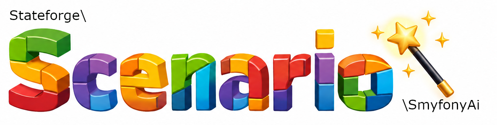

---

# Stateforge Scenario Symfony AI

**Generate Scenarios and Parameter Types using artificial intelligence.**

Stateforge Scenario Symfony AI extends the Stateforge Scenario Symfony framework with AI-assisted code generation.

Instead of writing every Scenario or Parameter Type manually, describe what you want to achieve in natural language. Scenario AI uses the framework documentation, predefined code blueprints, and optional project-specific information to generate PHP code that follows the conventions of the Scenario Symfony framework.

The generated code is validated and saved for review before activation.

## Philosophy

Stateforge Scenario Symfony AI is intended to assist developers, not replace their judgment.
The developer describes the desired application state or Parameter Type.
The AI helps translate that description into framework-compatible PHP code.
The Scenario Symfony framework provides the structure, conventions, and validation mechanisms.
The developer remains responsible for reviewing and approving the generated implementation.

**Describe the state. Generate the code. Review the result.**   

## Features

- **Natural language code generation** – Generate Scenarios and Parameter Types by describing their intended behavior.
- **Framework-aware generation** – Uses Scenario Symfony documentation, configuration, and code blueprints to guide the AI.
- **Interactive conversations** – The AI can ask follow-up questions when additional information is required.
- **Project context** – Optionally provide project-specific documentation to improve generated results. Control the use of project-specific information with `allowProjectInformation` in `scenario-ai.xml`.
- **Controlled source code access** – The AI can request access to existing PHP classes. Source code is only shared after explicit user confirmation.
- **Code validation** – Generated PHP code is validated before being saved.
- **Review before activation** – Generated files remain inactive until reviewed and renamed.
- **Extensible AI integration** – Supports custom AI adapters.

## Requirements

Stateforge Scenario AI requires an existing Stateforge Scenario Symfony installation:
- [stateforge/scenario-symfony](https://github.com/laloona/scenario-symfony) >= 1.2

The Scenario AI extension uses the framework's configuration, Scenario suites, Parameter Type directory, and extension system.

## Installation

> This package is intended for test and development use only.

Install the Scenario AI package in a project that already uses Stateforge Scenario via Composer as a development dependency.
```bash
composer require --dev stateforge/scenario-symfony-ai
```

## Generating a Scenario

A Scenario describes how to prepare a specific application state.

For example, consider an application that needs three users in a fresh database for testing.

Start Scenario AI:

```bash
php bin/console scenario:ai:make
```

Enter a request such as:

> Create a Scenario that creates three new users of the class App\Entity\User in a fresh database.

Scenario Symfony AI uses the request, framework documentation, and configured Scenario suites to generate a corresponding PHP class.

Depending on the available project information, the generated code may include attributes such as:

```php
#[AsScenario(
    name: 'create-three-users-in-fresh-database',
    description: 'Creates three users in a fresh database.'
)]
#[RefreshDatabase]
```

The generated implementation depends on the information available about the application's entities and persistence layer.

If the AI does not know how your application creates or persists users, it may generate TODO comments instead of inventing application-specific APIs.

For example:

```php
public function up(): void
{
    // TODO: Instantiate three App\Entity\User objects.
    // TODO: Set the required fields according to the entity API.
    // TODO: Persist the users using the project's persistence layer.
}
```

This allows Scenario Symfony AI to generate a useful starting point without making unverifiable assumptions about your application.

## Generating a Parameter Type

Parameter Types define how Scenario parameters are represented and processed.

Scenario Symfony AI can generate Parameter Types from natural language descriptions.

Start the generator:

```bash
php bin/console scenario:ai:make
```

Enter a request such as:

> Create a Parameter Type that accepts a date of birth and converts it into a DateTimeImmutable instance.

Scenario Symfony AI uses the Parameter Type blueprint and framework documentation to generate the corresponding PHP class.

Generated implementations can include methods such as:

- `constraints()` – Converts the supplied value into the required representation.
- `valueType()` – Defines the supported input value type.

As with Scenarios, generated Parameter Types must be reviewed before activation.

## Architecture

Scenario Symfony AI separates the responsibilities involved in AI-assisted code generation.

### Context

The context provides the instructions and validators used during generation.

It combines the Scenario Symfony framework documentation, code blueprints, and optional project-specific information.

### Instructions

Instructions describe the framework conventions and requirements that generated code should follow.

They provide the AI with the information needed to produce compatible Scenarios and Parameter Types.

### AI Adapters

Adapters handle communication with individual AI providers.

Each adapter is responsible for creating a client that communicates with its provider.

### Conversation Management

Conversation management coordinates requests, responses, follow-up questions, and generation attempts.

### Response Processing

Structured AI responses are converted into internal response objects.
These responses contain the generated code and additional information required by the generation workflow.

### Validation

Validators inspect generated results before they are accepted.
The validation process is independent of the selected AI provider.

### AST Processing

Scenario AI uses PHP's Abstract Syntax Tree representation to analyze generated code.
The AST is used to determine structural information such as the generated class name and namespace.

### File Generation

The code generation component determines the destination directory based on the Scenario configuration and the generated class namespace.
Generated code is written to a file with an `.ai` suffix.

## Security and Privacy

Scenario AI is designed to keep the developer in control of the generation process.

### Source Code Sharing

When the AI requests access to an existing project class, the interactive command asks for confirmation before sending its source code.
Declining the request prevents that class from being shared through this mechanism.

### Project Documentation

Project-specific documentation is optional.
Only configure documentation that is appropriate to share with the selected AI provider.

The `allowProjectInformation` attribute in `scenario-ai.xml` controls whether project-specific information may be included in the AI context:

```xml
<scenario-ai allowProjectInformation="true">
    <!-- Adapter configuration -->
</scenario-ai>
```

Set it to `false` to disable project-specific information. This setting does not replace the separate confirmation step described above for sharing individual source files.

### API Credentials

API credentials should be treated as sensitive information.
Do not commit real API keys to public repositories.
Keep configuration files containing credentials outside version control.

### Generated Code

Generated PHP code is not automatically activated.
Files are saved with an `.ai` suffix and must be reviewed before activation.

### External AI Providers

The generation request, configured instructions, and any approved project context are transmitted to the selected AI provider.
Review the provider's privacy and data handling policies before using Scenario AI with sensitive project information.

### Developer Responsibility

AI-generated code may contain mistakes, incomplete implementations, or incorrect assumptions.
Validation improves reliability but does not guarantee correctness.
Always review generated code and test its behavior before using it in an application.

## Extensibility

Scenario Symfony AI is designed to be extensible.
Its architecture separates framework-specific generation logic from provider-specific communication.
This makes it possible to integrate additional AI providers while retaining the same core generation workflow.
Custom adapters can implement alternative communication mechanisms without changing the existing Scenario generation and validation components.

## Next Steps

- [Getting Started](docs/getting-started.md)
- [Configuration](docs/configuration.md)
- [Interactive Conversation](docs/conversation.md)
- [Code Generation Process](docs/generation.md)
- [AI Providers](docs/providers.md)
